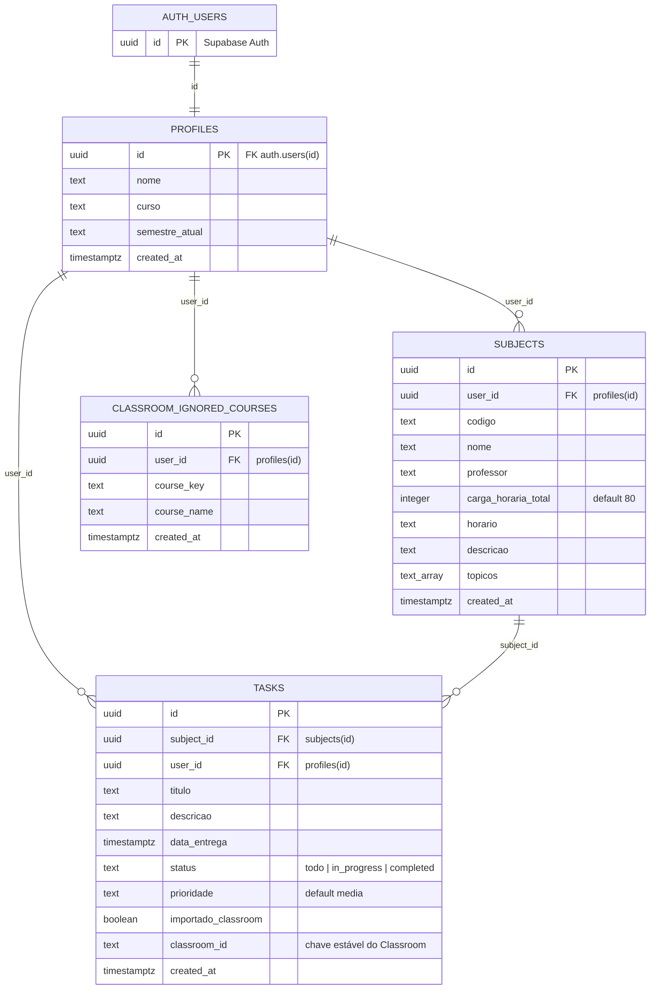

# Modelo de Dados – EduTrack AI

Banco: **Supabase (PostgreSQL)**, schema `public`. Fonte: `schema.sql` (raiz) e `supabase/migrations/`.
Conforme autorizado pelo professor, o Supabase substitui o Xano.

## Diagrama ER

## Tabelas

| Tabela | Para que serve | Chaves e restrições |
|---|---|---|
| `profiles` | Perfil do aluno (nome exibido na saudação, curso, semestre) | PK `id` = `auth.users.id` (apaga em cascata) |
| `subjects` | Disciplinas do semestre | FK `user_id` → `profiles(id)` (cascata); índice `idx_subjects_user_id` |
| `tasks` | Tarefas, entregas e provas (Kanban, prazos, progresso) | FK `subject_id` → `subjects(id)` e `user_id` → `profiles(id)` (cascata); índices `idx_tasks_user_id`, `idx_tasks_subject_id`; único `(user_id, classroom_id)` |
| `classroom_ignored_courses` | Turmas do Classroom que o aluno escolheu não importar | FK `user_id` → `profiles(id)` (cascata); único `(user_id, course_key)` |

## Segurança (RLS)
Todas as tabelas têm Row Level Security ativado, com quatro policies por tabela (`<tabela>_select_own`, `_insert_own`, `_update_own`, `_delete_own`) para o papel `authenticated`:
- `profiles`: `auth.uid() = id`
- `subjects`, `tasks`, `classroom_ignored_courses`: `auth.uid() = user_id`

Assim, cada usuário lê e altera apenas as próprias linhas, também pela API REST (`/rest/v1/<tabela>`).

## Observação sobre `academic_tasks`
A Tarefa 11 especificou a tabela como `academic_tasks` (campos `title`, `description`, `due_date`, `status`, `subject_id`). A tabela real é `public.tasks`; a correspondência campo a campo está no `README.md` ("Equivalências").
